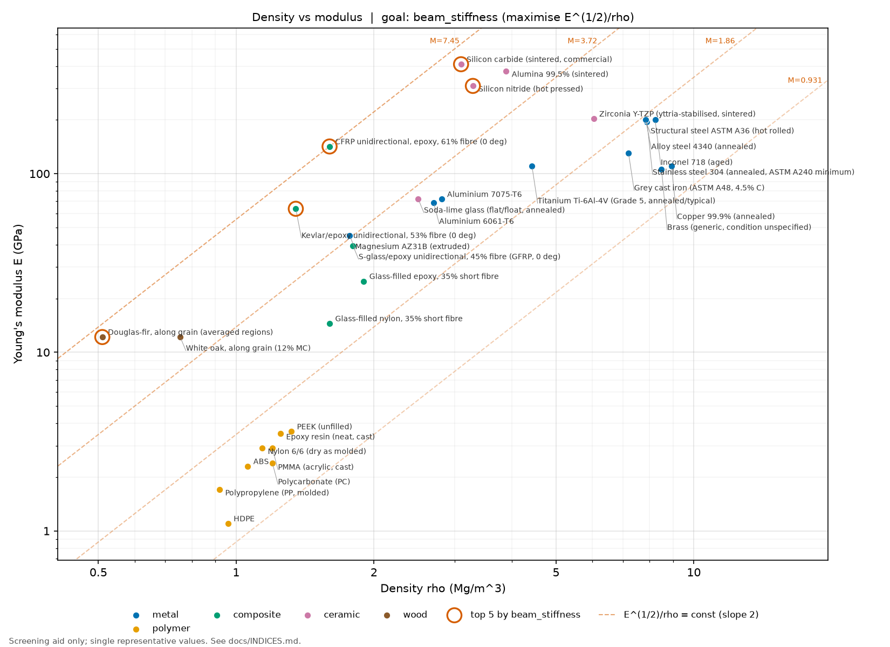
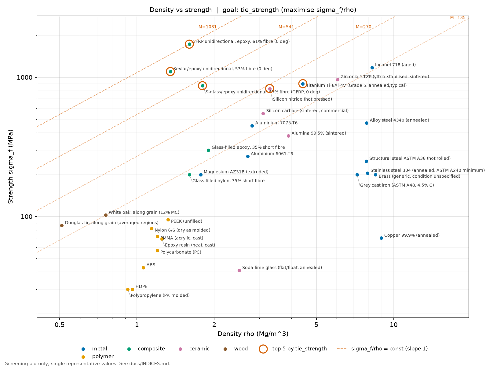

# material-selector

A Python command-line tool that ranks engineering materials for a design goal using Ashby material indices (lightest stiff beam, cheapest strong tie, and so on) and plots Ashby charts (density vs modulus, density vs strength).

The dataset has 31 materials in `data/materials.csv`, with a source for every row (see `data/SOURCES.md`).

## Quick start

```bash
git clone https://github.com/ahmedakmal2211-ship-it/material-selector.git
cd material-selector && pip install -e .[dev]
python -m material_selector rank --goal beam_stiffness --top 5
```

- The `material-selector` console script is also installed. Use it in place of `python -m material_selector` if your Python `Scripts` folder is on `PATH`.
- Use the editable install (`-e`) shown above. A normal (non-editable) install does not bundle the CSV. In that case point the tool at the data with `--data path/to/materials.csv` or the `MATERIAL_SELECTOR_DATA` environment variable.
- List all goals with `python -m material_selector goals`.

## Example output

`python -m material_selector rank --goal beam_stiffness --top 5` (the first line, which prints the path of the data file in use, is left out here):

```text
Goal: beam_stiffness - Light, stiff beam. Maximise E^(1/2)/rho [GPa^(1/2)/(Mg/m^3)]
rank  material                                        class      index  rho kg/m3  E GPa  sigma MPa  basis     USD/kg
----  ----------------------------------------------  ---------  -----  ---------  -----  ---------  --------  ------
1     CFRP unidirectional, epoxy, 61% fibre (0 deg)   composite  7.448  1600       142    1730       tensile   60
2     Douglas-fir, along grain (averaged regions)     wood       6.84   510        12.17  86.2       flexural  0.6
3     Silicon carbide (sintered, commercial)          ceramic    6.532  3100       410    550        flexural  50
4     Kevlar/epoxy unidirectional, 53% fibre (0 deg)  composite  5.907  1350       63.6   1100       tensile   50
5     Silicon nitride (hot pressed)                   ceramic    5.352  3290       310    830        flexural  100

31 ranked, 0 excluded by limits, 0 skipped (missing data).
Note: strength values mix bases (flexural, tensile, yield); yield, tensile and flexural strengths are not directly comparable.
Screening aid only (single representative values, see docs/INDICES.md); not a design check.
```

### Ashby charts

Density vs modulus, with the top 5 for `beam_stiffness` circled and lines of constant index drawn:

```bash
python -m material_selector chart --kind modulus --goal beam_stiffness --out docs/ashby_density_modulus.png
```



Density vs strength, with the top 5 for `tie_strength` circled:

```bash
python -m material_selector chart --kind strength --goal tie_strength --out docs/ashby_density_strength.png
```



## Goals

Each goal maximises one index M. Units are as printed by the tool (density in Mg/m^3, E in GPa, strength in MPa, cost in USD/kg).

| Goal | What it ranks | Index (maximise) | Units |
|---|---|---|---|
| `tie_stiffness` | Light, stiff tie (tension member) | E / rho | GPa/(Mg/m^3) |
| `tie_strength` | Light, strong tie | sigma_f / rho | MPa/(Mg/m^3) |
| `tie_strength_cost` | Cheapest strong tie | sigma_f / (C_m rho) | MPa/((USD/kg)(Mg/m^3)) |
| `beam_stiffness` | Light, stiff beam (square section) | E^(1/2) / rho | GPa^(1/2)/(Mg/m^3) |
| `beam_strength` | Light, strong beam (square section) | sigma_f^(2/3) / rho | MPa^(2/3)/(Mg/m^3) |
| `beam_stiffness_cost` | Cheapest stiff beam | E^(1/2) / (C_m rho) | GPa^(1/2)/((USD/kg)(Mg/m^3)) |
| `panel_stiffness` | Light, stiff panel (fixed width, free thickness) | E^(1/3) / rho | GPa^(1/3)/(Mg/m^3) |
| `panel_strength` | Light, strong panel | sigma_f^(1/2) / rho | MPa^(1/2)/(Mg/m^3) |
| `column_buckling` | Light column against elastic buckling (alias of `beam_stiffness`) | E^(1/2) / rho | GPa^(1/2)/(Mg/m^3) |

## Screening limits

Indices rank; limits remove materials before ranking. Limits are inclusive, and a material with a missing value never passes a limit that uses it.

| Option | Meaning |
|---|---|
| `--min-modulus GPA` | minimum Young's modulus |
| `--min-strength MPA` | minimum strength |
| `--max-density KG_M3` | maximum density |
| `--max-cost USD_KG` | maximum cost |
| `--class CLASS [CLASS ...]` | allowed classes: metal, polymer, composite, ceramic, wood |
| `-v`, `--verbose` | list excluded and skipped materials with reasons |

Example: the cheapest strong tie among metals and polymers that are at least 200 MPa and cost no more than 5 USD/kg:

```bash
python -m material_selector rank --goal tie_strength_cost --min-strength 200 --max-cost 5 --class metal polymer --top 5
```

```text
Goal: tie_strength_cost - Cheapest strong tie. Maximise sigma_f/(C_m*rho) [MPa/((USD/kg)*(Mg/m^3))]
rank  material                                class  index  rho kg/m3  E GPa  sigma MPa  basis    USD/kg
----  --------------------------------------  -----  -----  ---------  -----  ---------  -------  ------
1     Aluminium 6061-T6                       metal  33.33  2700       69     270        yield    3
2     Aluminium 7075-T6                       metal  32.03  2810       72     450        yield    5
3     Structural steel ASTM A36 (hot rolled)  metal  31.97  7820       200    250        yield    1
4     Alloy steel 4340 (annealed)             metal  29.94  7850       200    470        yield    2
5     Grey cast iron (ASTM A48, 4.5% C)       metal  27.78  7200       130    200        tensile  1

7 ranked, 24 excluded by limits, 0 skipped (missing data).
Note: strength values mix bases (tensile, yield); yield, tensile and flexural strengths are not directly comparable.
Screening aid only (single representative values, see docs/INDICES.md); not a design check.
```

## How it works

For each goal the tool uses an Ashby-style performance index: write the objective (minimise mass or cost) and the constraint (stiffness or strength), eliminate the free section size, and read off the material group M to maximise. It assumes isotropic, linear-elastic material, fixed length and load, and a solid square section for beams and columns (a panel has fixed width and free thickness). Strength is one value per material. Fatigue, creep, thin-wall buckling, temperature, corrosion, joining and manufacturability are not modelled, and cost indices rank material cost, not finished-part cost. Derivations, assumptions and hand-checked reference values are in [docs/INDICES.md](docs/INDICES.md).

## Data and its limits

- Each property is a single representative value. Real properties vary widely with alloy, temper, grade, fibre fraction and direction.
- Costs are indicative, order-of-magnitude figures, not quotes. Several are reasoned estimates marked unverified in the `notes` column.
- The strength basis differs between rows (yield, tensile or flexural). The tool prints a note when a ranking mixes bases; the values are not directly comparable.
- Some rows use a specification minimum instead of a typical value, for example stainless steel 304 (ASTM A240 minimum yield, 205 MPa).
- Near-tied ranks are within the uncertainty of the data. Do not read a small gap in the index as a real difference.
- Wood and composites are anisotropic. Their figures are along-grain or along-fibre, as stated per row.
- Ceramic flexural strength is not a safe design stress without a statistical (Weibull) approach.

Sources for every row are listed in [data/SOURCES.md](data/SOURCES.md).

## Disclaimer

This is a screening aid for study and concept work. It is not a design check and not certification. Use proper standards, tested material data and a competent engineer's sign-off for any real design.

## Tests

```bash
python -m pytest -q
```

Expected result with the current code: `105 passed`.

## Licence

MIT. See [LICENSE](LICENSE).

Copyright (c) 2026 Akmal Azeem
